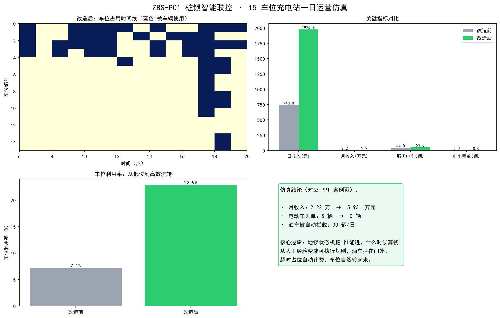
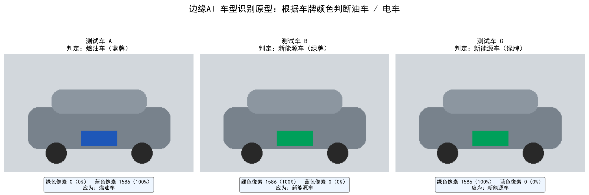

# ZBS-P01｜桩锁智能联控仿真

一个用于展示充电车位准入、充电与占位计费思路的 Python 原型，包含运营规则仿真和车牌颜色阈值识别两个独立演示模块。

**在线交互仿真：**[打开 GitHub Pages 演示](https://xiao2007-cosimo.github.io/XIAO2007-COSIMO/projects/zbs-pile-lock-control/)。页面用浏览器 JavaScript 复现合成场景逻辑；Python 版本和识别原型代码也保存在本项目中。

> **项目边界：**运营数据由程序按设定参数合成；车型识别图片由程序绘制。当前版本不连接真实充电桩、地锁、摄像头，也没有使用现场运营数据。图表用于解释原型逻辑，不能作为实际收入、节能效果或部署效果的证明。

## 演示效果

### 桩锁联控运营仿真

比较“人工管理”和“车型准入＋超时占位计费”两组规则。两组方案使用相同的合成到达事件，车位总占用比例按分钟累计（燃油车和新能源车都计入）。

下图是项目作者提供的整理前截图，仅用于展示原型外观。旧截图中的利用率数字来自旧统计逻辑，不代表当前代码结果；当前脚本已改为逐分钟统计所有车辆的实际占位。运行脚本后会生成并覆盖新版图表。车型识别截图也保留了旧标题，实际算法以当前代码和下文说明为准。



图中的 30 天收入是单日仿真结果乘以 30 的情景推算，不是月度预测或实测数据。

### 车牌颜色阈值识别

示例车辆和车牌由脚本绘制。程序对整张合成图片统计 HSV 颜色阈值；它不是训练得到的 AI 模型，也没有真实车牌定位或字符识别。



## 功能

- 模拟 15 个车位在 6:00–20:00 的车辆到达与车位状态变化。
- 用泊松到达率、早晚高峰、车型占比和停留时间构造合成场景。
- 对比人工准入与智能准入规则下的收入估算、服务车辆数、丢单数和全车辆车位占用比例。
- 使用 HSV 阈值演示蓝色/绿色车牌色块的分类思路。
- 将仿真图输出到 `assets/`。

两个脚本是独立原型：运营仿真中的车型由设定概率生成，**不会调用**颜色识别脚本。

## 环境与运行

- Python 3.9 或更高版本
- NumPy、Matplotlib、Pillow

```bash
python -m pip install -r requirements.txt
python smart_lock_sim.py
python vehicle_plate_color_demo.py
```

运行后会刷新 `assets/operations-simulation.png` 和 `assets/vehicle-type-demo.png`。

浏览器交互版为静态页面，直接打开 `index.html` 即可调整场景参数并查看结果；它不需要 Python 环境。

## 可调参数

可在 `smart_lock_sim.py` 文件开头调整车位数、营业时间、到达率、车型比例、充电功率及收费规则。每次修改参数后重新运行，图表会按新的假设重新生成。

| 参数 | 默认值 | 含义 |
|---|---:|---|
| `N_SPACES` | 15 | 模拟车位数 |
| `OPEN_FROM` / `OPEN_TO` | 6 / 20 | 模拟营业时段 |
| `OFFPEAK_ARRIVAL` | 4 辆/小时 | 平峰到达率 |
| `PEAK_ARRIVAL` | 11 辆/小时 | 高峰到达率 |
| `P_EV` | 0.60 | 合成到达车辆中的新能源车比例 |
| `P_CHARGING` | 0.85 | 新能源车中选择充电的比例 |
| `CHARGE_FEE_PER_KWH` | 1.20 元/度 | 充电服务费假设 |
| `PILING_FEE_15MIN` | 5 元/15 分钟 | 超时占位费假设 |

这些默认值是演示参数，修改前请勿将图表数字解释为真实经营结果。

## 当前限制

1. 仿真采用规则和随机参数，没有拟合或校准真实场站数据。
2. 车牌演示只比较整张合成图片的颜色像素；现实环境中的光照、反光、遮挡、背景和车牌位置都会影响结果。
3. 识别原型没有训练模型、车牌区域检测、字符 OCR、摄像头输入、桩锁通信或异常处理。
4. 运营仿真与识别演示尚未集成，也没有硬件联调或现场验证。
5. 30 天收入只是单日假设的线性外推，没有考虑周末、季节、故障、价格变化、设备容量或用户行为变化。

## AIforGreen B 赛道说明

如果将该原型用于 AIforGreen B 赛道展示，还需要按赛事要求基于主办方提供的充电数据开展分析并验证产品效果。本仓库当前的合成数据不能替代赛事数据，也不能据此宣称有真实节能或减排效果。

## 项目整理说明

原型代码和演示图片由项目作者提供。本次整理统一了目录和文件名、重写了项目说明，并修正了仿真对比共用输入及车位占用率按分钟统计的逻辑；这些整理工作使用了 AI 编程辅助。参赛路演时请按赛事要求说明工具使用情况。

## 许可证

当前仓库未附开源许可证。发布前如希望他人可以复用、修改或分发代码，请先选择并添加合适的许可证；没有许可证时，默认著作权仍由作者保留。
